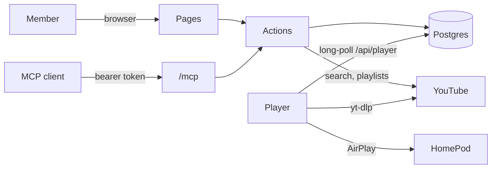

```
███╗   ███╗██╗   ██╗███████╗██╗ ██████╗
████╗ ████║██║   ██║██╔════╝██║██╔════╝
██╔████╔██║██║   ██║███████╗██║██║
██║╚██╔╝██║██║   ██║╚════██║██║██║
██║ ╚═╝ ██║╚██████╔╝███████║██║╚██████╗
╚═╝     ╚═╝ ╚═════╝ ╚══════╝╚═╝ ╚═════╝
```

# WinLab Music

> [!IMPORTANT]
> Archived on 2026-10-24. Music now lives in the portal at [portal.winlab.tw/music](https://portal.winlab.tw/music) ([NYCU-WinLab/portal](https://github.com/NYCU-WinLab/portal)), and music.winlab.tw redirects there.

> The lab's shared music queue: members search YouTube Music or paste a link, and a small player streams the queue to the lab HomePod over AirPlay.

`nextjs` `postgres` `airplay` `docker` `mcp`

[](https://github.com/NYCU-WinLab/music/actions) &nbsp;[](https://github.com/NYCU-WinLab/music/pkgs/container/music) &nbsp;[](#license)

Any device with a browser can put a song on the lab speaker, whether it speaks AirPlay, Google Cast or neither. Everyone sees the same queue live: who added each song, who cut in, and who skipped it.

```
> "Play アイドル after this song"
  ⚡ search_music { "query": "YOASOBI アイドル" }
  ⚡ add_song { "videoId": "m9SMT5ipbxk", "as": "next" }
✓ { "itemId": "d1850a3d-…", "already": false }
```

## What it does

- **Searches YouTube Music** for songs as you type, and takes pasted song or playlist links from YouTube or YouTube Music.
- **Queues three ways**: at the end, next, or cut in now (the cut song goes back to the front and resumes where it was).
- **Shows who**: who added each song, and a feed of who added, cut in, skipped, paused or changed the volume.
- **Adds playlists**: up to 200 songs from one link.
- **Shares one set of controls**: pause, skip and volume act for everyone.
- **Gets out of the door greeting's way**: when another AirPlay sender takes the HomePod, the player waits until it is quiet and resumes.
- **Serves MCP** at `/mcp`, with music as the OAuth 2.1 authorization server.

## Deploy

The web app runs anywhere with Docker:

```sh
curl -fsSLO https://raw.githubusercontent.com/NYCU-WinLab/music/main/compose.yaml
curl -fsSL -o .env https://raw.githubusercontent.com/NYCU-WinLab/music/main/.env.example
# set POSTGRES_PASSWORD, BETTER_AUTH_*, KEYCLOAK_* and PLAYER_TOKEN in .env
docker compose up -d
```

The player runs on a Linux machine on the speaker's network:

```sh
sudo MUSIC_URL=https://music.example.com PLAYER_TOKEN=<same token> \
  HOMEPOD_NAME=<speaker name> sh player/install.sh
```

> [!IMPORTANT]
> Put a reverse proxy with TLS in front of web, at the host in `BETTER_AUTH_URL`. The player only calls out to web, so it needs no inbound port.

## Use

1. In your Keycloak realm, create a confidential OpenID Connect client with the redirect URI `<BETTER_AUTH_URL>/api/auth/callback/keycloak`, and put its ID and secret in `.env`. Give its service account `view-users` so `/mcp` can check that a member still exists.
2. Open `BETTER_AUTH_URL`, sign in, and search for a song.
3. Add the MCP server to a client, for example `claude mcp add --transport http music <BETTER_AUTH_URL>/mcp`, then ask it what is playing.

## Configure

Set these in `.env`; [.env.example](.env.example) documents every one.

| Key | What it sets | Default |
|-----|--------------|---------|
| `POSTGRES_PASSWORD` | The database password, used by every service | required |
| `BETTER_AUTH_URL` | The public URL; the MCP resource is `<url>/mcp` | required |
| `BETTER_AUTH_SECRET` | Signs sessions and OAuth queries | required |
| `KEYCLOAK_ISSUER` | The realm URL, e.g. `https://auth.example.com/realms/lab` | required |
| `KEYCLOAK_CLIENT_ID`, `KEYCLOAK_CLIENT_SECRET` | Music's Keycloak client | required |
| `PLAYER_TOKEN` | The player's Bearer token for `/api/player` | required |
| `MUSIC_VERSION` | Image tag | `main` |
| `MUSIC_BIND`, `MUSIC_PORT` | Where web listens on the host | `127.0.0.1`, `3000` |
| `OTEL_EXPORTER_OTLP_ENDPOINT` | OTLP/HTTP endpoint for traces and error logs; off when empty | empty |

## How it works



Postgres holds the queue, and one item at most is playing. Every change bumps the player's version; the player long-polls `/api/player` and follows: it fetches the audio with yt-dlp (and the next two songs ahead), streams it through ffmpeg to the HomePod with pyatv, and reports loading, playing, ended or failed. Pages follow the same changes through Postgres NOTIFY and `/api/events`.

## Develop

```sh
bun install
cp .env.example .env.local   # point DATABASE_URL at a local Postgres
bun run db:migrate
bun run dev
```

Run the player against it with `MUSIC_URL=http://<dev host>:3000`; it needs `ffmpeg`, `yt-dlp` and Deno (yt-dlp solves YouTube's player challenge with it). See [CLAUDE.md](CLAUDE.md) for the conventions.

## Limitations

- One speaker per deployment.
- The player is Python, the one exception: pyatv is the only AirPlay sender library that streams to a HomePod.
- YouTube changes break yt-dlp now and then; the player's timer upgrades it daily.

## Contributing

Issues and PRs welcome: start with [CONTRIBUTING.md](https://github.com/zyx1121/.github/blob/main/CONTRIBUTING.md).

## License

[MIT](LICENSE), made in a lab that argues about the next song.
